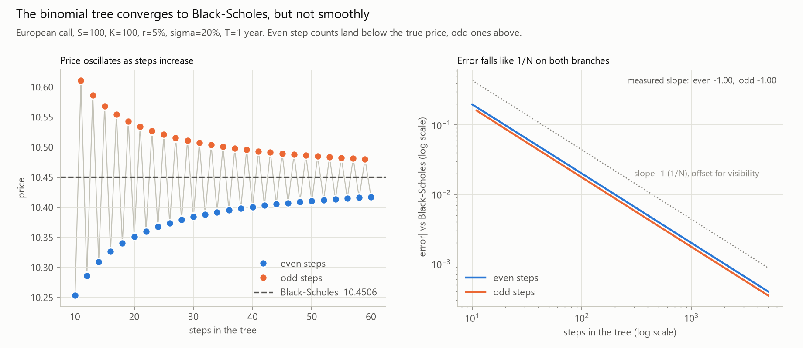
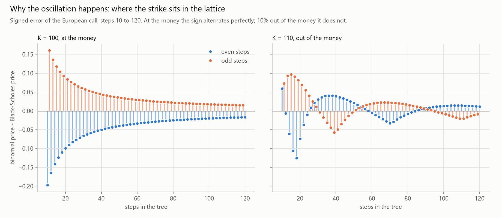
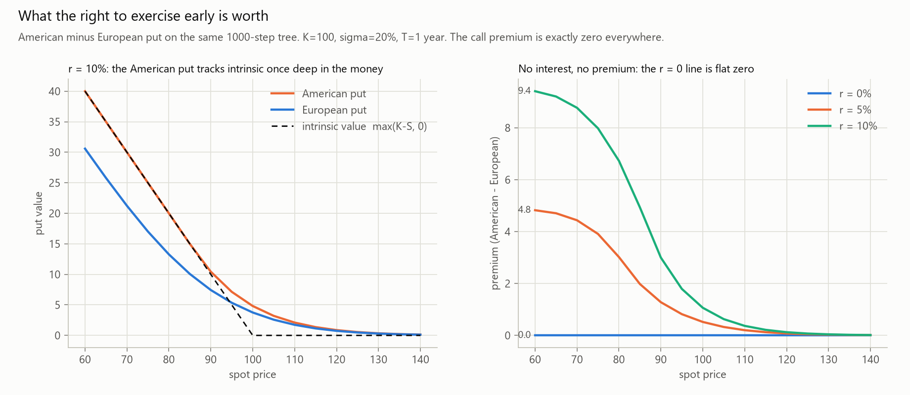
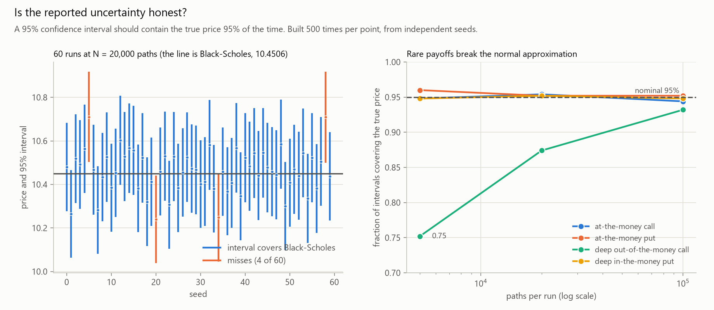
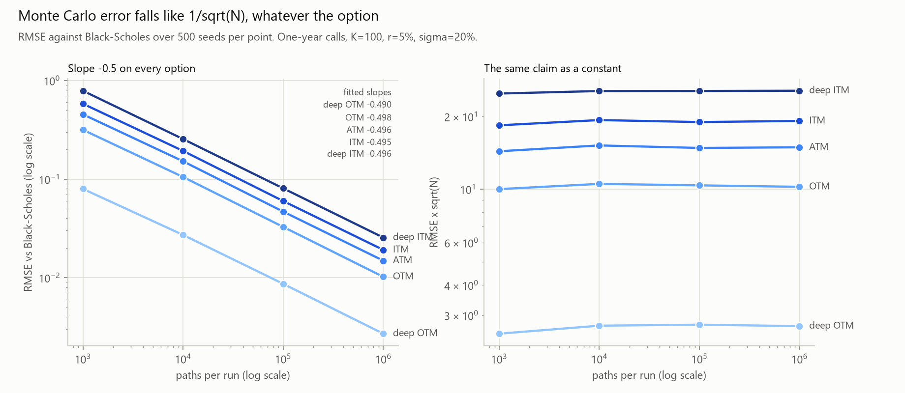
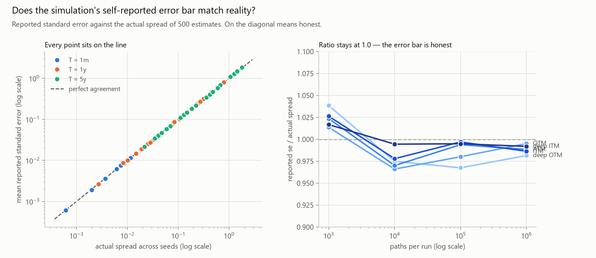
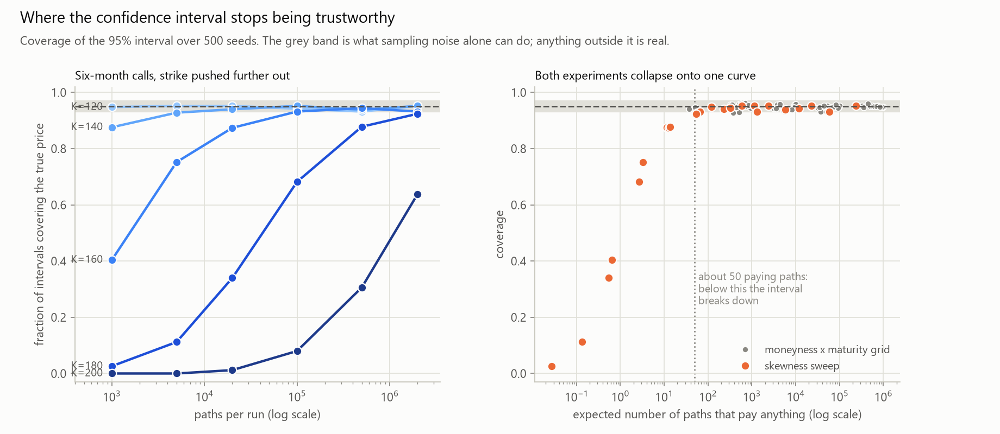
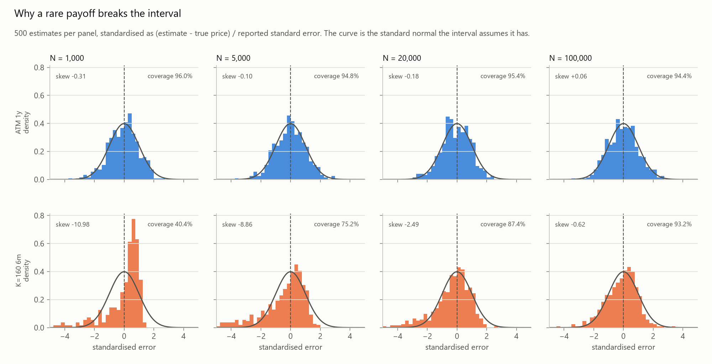
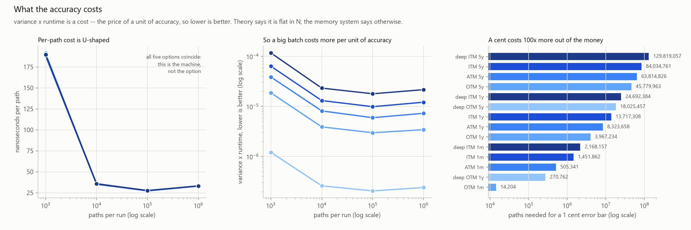

# Computational Derivatives Pricing & Risk Engine

**How do numerical and variance-reduction techniques affect the accuracy and computational
efficiency of Monte Carlo option pricing?**

A computational research project rather than a calculator: price the same European option by
closed form, by binomial tree and by Monte Carlo, then measure how accuracy and runtime respond
to the numerical choices. Python (NumPy, SciPy, matplotlib, pytest) for Phases 1–4; C++17 for the
performance work in Phase 5.

## Status

| Phase | What | State |
|---|---|---|
| 1 | Black-Scholes prices and the five Greeks | **done** |
| 2 | Binomial tree (CRR), European and American; Monte Carlo under GBM | **done** |
| 3 | Monte Carlo convergence: error, standard error, runtime, the 1/√N law | **done** |
| 4 | Antithetic and control variates; variance reduction and time-adjusted efficiency | not started |
| 5 | C++ Monte Carlo core; Python vs NumPy vs C++ benchmarks | not started |

2,856 tests pass across the three models and the experiment harness.

**Phase 1** — `call_price`, `put_price` and `delta`/`gamma`/`vega`/`theta`/`rho` for both option
types: Hull's worked examples, put-call parity, every Greek against a central finite difference,
and the edge cases (expiry now, zero and extreme volatility, deep in and out of the money).

**Phase 2** — a Cox-Ross-Rubinstein tree (European and American) and a Monte Carlo pricer under
geometric Brownian motion, with the convergence and coverage experiments below.

**Phase 3** — a reusable experiment harness, and a convergence study over 16 options × 4 path
counts × 500 seeds.

## Phase 2 results

Run `python analysis/run_phase2.py` (~25 s) then `python analysis/plot_phase2.py`.

### The tree converges to Black-Scholes at 1/N — in a zigzag



Quadruple the steps and the error quarters: at the money `error × N` holds at 1.995 → 2.000 from
N=50 to N=3,200, and the fitted log-log slope is −1.00 on both branches.

The zigzag is not noise. At the money, an **even** number of steps puts a terminal node *exactly*
on the strike while an **odd** number leaves the strike between two nodes, so even trees
consistently undershoot the true price and odd trees overshoot. Averaging an N and N+1 pair
cancels most of the error — the 5000/5001 average lands at 7.1% of the better single error.



Ten percent out of the money the strike is at neither place, and it drifts between nodes as N
grows, so the sign flips in slow groups rather than alternating. Same mechanism, different view.

### What early exercise is worth



| spot | American put | European put | premium | call premium |
|---|---|---|---|---|
| 60 | 40.00 | 30.59 | **9.41** | 0.00000000 |
| 80 | 20.00 | 13.27 | **6.73** | 0.00000000 |
| 100 | 4.82 | 3.75 | **1.06** | 0.00000000 |
| 140 | 0.13 | 0.12 | **0.01** | 0.00000000 |

K=100, σ=20%, T=1, r=10%, 1000-step trees. The American **call** premium is exactly zero in all 51
rows — without dividends, exercising a call early is never optimal. The put premium is real, and
it vanishes completely when r=0: it is interest on the strike you collect by exercising sooner,
not extra optionality. Below spot 85 (at r=10%) the American put equals its intrinsic value — the
tree has worked out that exercising immediately beats waiting.

### Is the simulation's error bar honest?



Build a 95% interval 500 times from independent seeds and count how often it contains the true
price. For a normal option it covers 94.4–96.0% of the time, against a nominal 95% ± 1.0.

For a deep out-of-the-money call (worth 0.004, so almost every path pays nothing) coverage falls
to **75.2%** at N=5,000, recovering to 87.4% and 93.2% as paths increase: the payoff is too skewed
for the central limit theorem the interval relies on. The deep in-the-money put at the same strike
covers 94.8–95.2%, which pins the cause on skewness rather than on moneyness.

## Phase 3 results

Run `python analysis/run_phase3.py` (~9 min) then `python analysis/plot_phase3.py`.

Everything is measured over **500 independent seeds per point**, because one Monte Carlo run says
nothing about a method — it gives one price and one self-reported error bar, both random.

### The error falls like 1/√N, whatever the option



Fitted log-log slope of RMSE against paths: **−0.496** for the base case, **−0.490 to −0.501**
across all 16 options. A 1,000× increase in paths buys a 30.5× accuracy improvement (theory:
√1000 = 31.6). Only the constant in front changes between options.

### The error bar is honest



Across all 64 points the reported standard error matches the actual spread of the 500 estimates
to within **0.966–1.038**, over four orders of magnitude. That is what makes the standard error
useful: it estimates an accuracy you could not otherwise see without already knowing the answer.

### …until the payoff becomes a rare event



Coverage held at 0.93–0.96 across the whole moneyness × maturity grid — *including* a deep
out-of-the-money call with payoff skewness 8.71. Being far out of the money is not enough to
break the interval.

What breaks it is how many paths pay anything at all. Pushing the strike from 120 to 200 at six
months, both experiments collapse onto one curve:

| expected paying paths | 0.03 | 0.65 | 3.2 | 13 | 57 | 118 | 1,145 | 236,016 |
|---|---|---|---|---|---|---|---|---|
| coverage | 0.026 | 0.404 | 0.752 | 0.874 | 0.928 | 0.948 | 0.952 | 0.952 |

**Below about 50 paying paths per run the interval cannot be trusted; below 5 it is worthless.**



The mechanism, drawn directly: standardising each estimate by its own reported standard error
should give a standard normal. At N=1,000 the K=160 call instead gives a spike just below +1 with
a long left tail — the "exactly one paying path" signature. With a single payoff `X` among `N`
paths, the estimate is `X/N` and the standard error is also ≈ `X/N`, so the ratio pins near +1
whatever `X` was. **The estimator is most confident precisely when it has least information.**

### What the accuracy costs



A ±1 cent 95% error bar costs **8.3M paths (0.23 s)** for the at-the-money one-year call, rising
to **130M paths (3.6 s)** deep in the money at five years. One more decimal place costs 100× the
paths — the case for Phase 4's variance reduction.

`variance × runtime` is a **cost** — the price of a unit of accuracy, so lower is better. Theory
says it should be flat in N. It is not: variance falls exactly like 1/N, but runtime per path is
U-shaped (189 ns at N=1,000 from fixed per-call overhead, 27 ns at N=100,000, 33 ns at
N=1,000,000 as the arrays leave cache), so the cost *rises* from 3.2e-6 to 7.7e-6. A big batch
buys less accuracy per second than a medium one, and the sweet spot here is around N=100,000.
Phase 4 therefore compares estimators at equal path counts.


## Layout

```
src/pricing/common.py          option kinds, input validation, the exercise payoff
src/pricing/black_scholes.py   closed-form prices and Greeks
src/pricing/binomial.py        Cox-Ross-Rubinstein tree, European and American
src/pricing/monte_carlo.py     GBM simulation with standard error and confidence interval
tests/                         pytest suite (textbook values, parity, finite differences,
                               edge cases, CI coverage)
analysis/run_phase2.py         runs the experiments, writes results/*.csv
analysis/plot_phase2.py        reads the CSVs, prints the tables, writes results/*.png
results/                       experiment CSVs and charts (committed, so the write-up can cite them)
requirements.txt               numpy, scipy, matplotlib, pytest
pytest.ini                     puts src/ on the import path
```

Every docstring explains the maths before the code: what `d1` and `d2` mean, why `d = 1/u` makes
the tree recombine, where the risk-neutral probability comes from, and why the Monte Carlo error
can only shrink like 1/√N.

## Running

```
python -m venv .venv
.\.venv\Scripts\python.exe -m pip install -r requirements.txt
.\.venv\Scripts\python.exe -m pytest
```

Conventions: rates and volatilities are decimals per year (5% → `0.05`), `T` is in years, vega is
per 1.0 of volatility and theta is per year. No dividends, European exercise only — the
Black-Scholes assumptions the write-up has to discuss.
