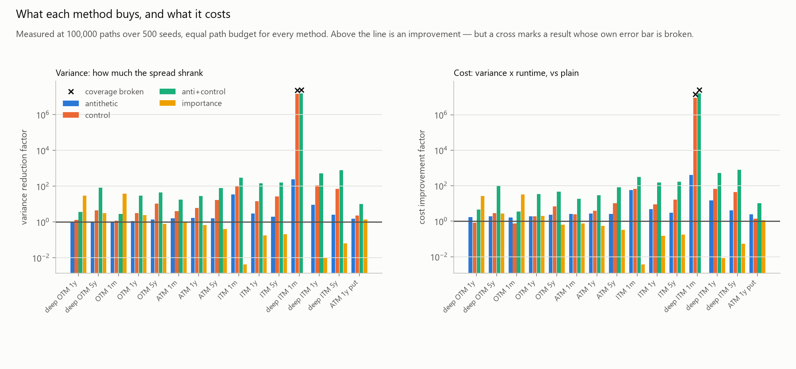
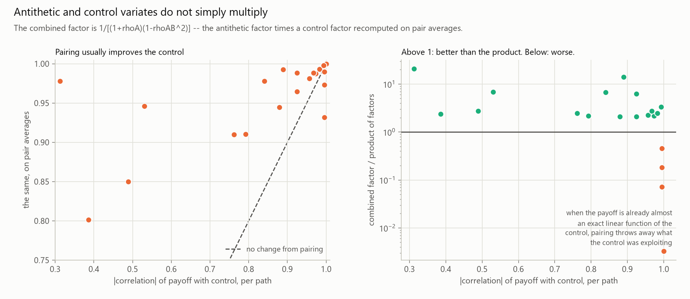
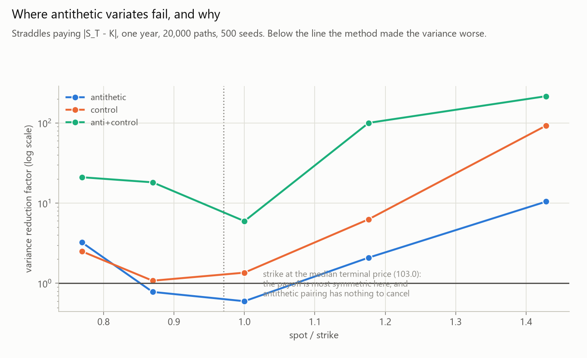
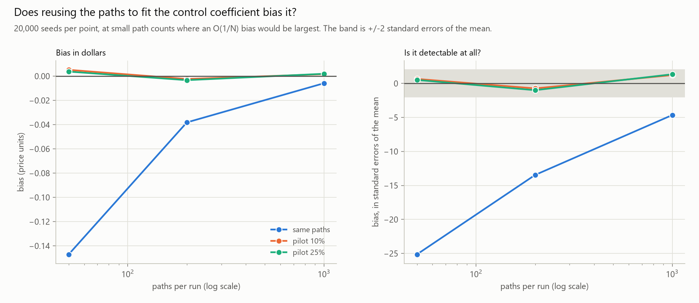
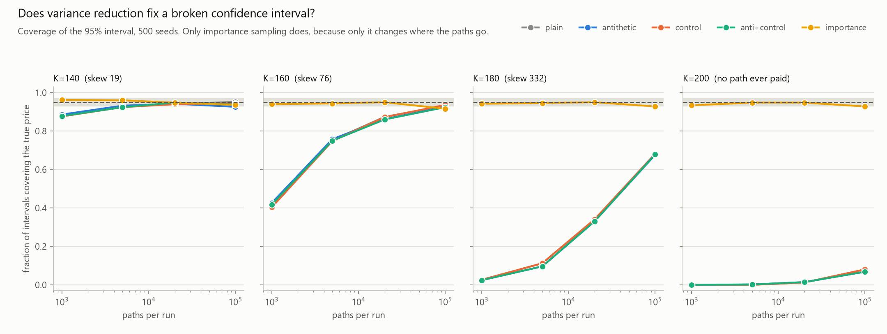
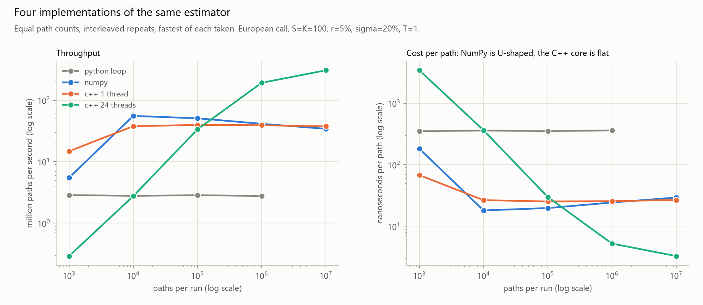
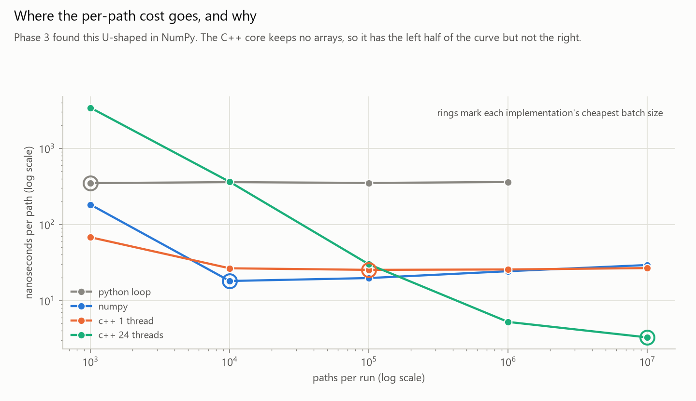
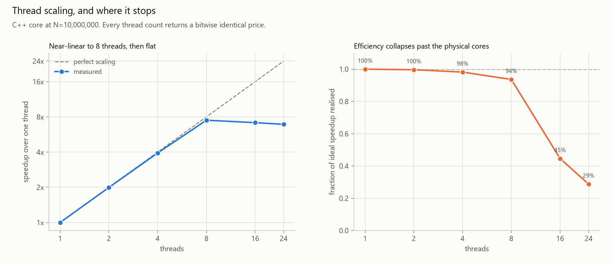

# Computational Derivatives Pricing & Risk Engine

**How do numerical and variance-reduction techniques affect the accuracy and computational
efficiency of Monte Carlo option pricing?**

A computational research project rather than a calculator: price the same European option by
closed form, by binomial tree and by Monte Carlo, then measure how accuracy and runtime respond
to the numerical choices. Python (NumPy, SciPy, matplotlib, pytest) for Phases 1–4; C++17 for the
performance work in Phase 5.

## Status

| Phase | What | State |
|---|---|---|
| 1 | Black-Scholes prices and the five Greeks | **done** |
| 2 | Binomial tree (CRR), European and American; Monte Carlo under GBM | **done** |
| 3 | Monte Carlo convergence: error, standard error, runtime, the 1/√N law | **done** |
| 4 | Antithetic and control variates; variance reduction and time-adjusted efficiency | **done** |
| 5 | C++ Monte Carlo core; Python vs NumPy vs C++ benchmarks | **done** |

2,950 tests pass across the models, the harness, the variance-reduced estimators and the
C++ engine.

**Phase 1** — `call_price`, `put_price` and `delta`/`gamma`/`vega`/`theta`/`rho` for both option
types: Hull's worked examples, put-call parity, every Greek against a central finite difference,
and the edge cases (expiry now, zero and extreme volatility, deep in and out of the money).

**Phase 2** — a Cox-Ross-Rubinstein tree (European and American) and a Monte Carlo pricer under
geometric Brownian motion, with the convergence and coverage experiments below.

**Phase 3** — a reusable experiment harness, and a convergence study over 16 options × 4 path
counts × 500 seeds.

**Phase 4** — antithetic variates, a control variate, both combined, and importance sampling, all
measured through the same harness at equal path counts.

**Phase 5** — the four estimators rewritten in C++17 and called through a C ABI, so they run
through that same harness: fast *and* demonstrably still correct.

## Phase 2 results

Run `python analysis/run_phase2.py` (~25 s) then `python analysis/plot_phase2.py`.

### The tree converges to Black-Scholes at 1/N — in a zigzag


Quadruple the steps and the error quarters: at the money `error × N` holds at 1.995 → 2.000 from
N=50 to N=3,200, and the fitted log-log slope is −1.00 on both branches.

The zigzag is not noise. At the money, an **even** number of steps puts a terminal node *exactly*
on the strike while an **odd** number leaves the strike between two nodes, so even trees
consistently undershoot the true price and odd trees overshoot. Averaging an N and N+1 pair
cancels most of the error — the 5000/5001 average lands at 7.1% of the better single error.


Ten percent out of the money the strike is at neither place, and it drifts between nodes as N
grows, so the sign flips in slow groups rather than alternating. Same mechanism, different view.

### What early exercise is worth


| spot | American put | European put | premium | call premium |
|---|---|---|---|---|
| 60 | 40.00 | 30.59 | **9.41** | 0.00000000 |
| 80 | 20.00 | 13.27 | **6.73** | 0.00000000 |
| 100 | 4.82 | 3.75 | **1.06** | 0.00000000 |
| 140 | 0.13 | 0.12 | **0.01** | 0.00000000 |

K=100, σ=20%, T=1, r=10%, 1000-step trees. The American **call** premium is exactly zero in all 51
rows — without dividends, exercising a call early is never optimal. The put premium is real, and
it vanishes completely when r=0: it is interest on the strike you collect by exercising sooner,
not extra optionality. Below spot 85 (at r=10%) the American put equals its intrinsic value — the
tree has worked out that exercising immediately beats waiting.

### Is the simulation's error bar honest?


Build a 95% interval 500 times from independent seeds and count how often it contains the true
price. For a normal option it covers 94.4–96.0% of the time, against a nominal 95% ± 1.0.

For a deep out-of-the-money call (worth 0.004, so almost every path pays nothing) coverage falls
to **75.2%** at N=5,000, recovering to 87.4% and 93.2% as paths increase: the payoff is too skewed
for the central limit theorem the interval relies on. The deep in-the-money put at the same strike
covers 94.8–95.2%, which pins the cause on skewness rather than on moneyness.

## Phase 3 results

Run `python analysis/run_phase3.py` (~9 min) then `python analysis/plot_phase3.py`.

Everything is measured over **500 independent seeds per point**, because one Monte Carlo run says
nothing about a method — it gives one price and one self-reported error bar, both random.

### The error falls like 1/√N, whatever the option


Fitted log-log slope of RMSE against paths: **−0.496** for the base case, **−0.490 to −0.501**
across all 16 options. A 1,000× increase in paths buys a 30.5× accuracy improvement (theory:
√1000 = 31.6). Only the constant in front changes between options.

### The error bar is honest


Across all 64 points the reported standard error matches the actual spread of the 500 estimates
to within **0.966–1.038**, over four orders of magnitude. That is what makes the standard error
useful: it estimates an accuracy you could not otherwise see without already knowing the answer.

### …until the payoff becomes a rare event


Coverage held at 0.93–0.96 across the whole moneyness × maturity grid — *including* a deep
out-of-the-money call with payoff skewness 8.71. Being far out of the money is not enough to
break the interval.

What breaks it is how many paths pay anything at all. Pushing the strike from 120 to 200 at six
months, both experiments collapse onto one curve:

| expected paying paths | 0.03 | 0.65 | 3.2 | 13 | 57 | 118 | 1,145 | 236,016 |
|---|---|---|---|---|---|---|---|---|
| coverage | 0.026 | 0.404 | 0.752 | 0.874 | 0.928 | 0.948 | 0.952 | 0.952 |

**Below about 50 paying paths per run the interval cannot be trusted; below 5 it is worthless.**


The mechanism, drawn directly: standardising each estimate by its own reported standard error
should give a standard normal. At N=1,000 the K=160 call instead gives a spike just below +1 with
a long left tail — the "exactly one paying path" signature. With a single payoff `X` among `N`
paths, the estimate is `X/N` and the standard error is also ≈ `X/N`, so the ratio pins near +1
whatever `X` was. **The estimator is most confident precisely when it has least information.**

### What the accuracy costs


A ±1 cent 95% error bar costs **8.3M paths (0.23 s)** for the at-the-money one-year call, rising
to **130M paths (3.6 s)** deep in the money at five years. One more decimal place costs 100× the
paths — the case for Phase 4's variance reduction.

`variance × runtime` is a **cost** — the price of a unit of accuracy, so lower is better. Theory
says it should be flat in N. It is not: variance falls exactly like 1/N, but runtime per path is
U-shaped (189 ns at N=1,000 from fixed per-call overhead, 27 ns at N=100,000, 33 ns at
N=1,000,000 as the arrays leave cache), so the cost *rises* from 3.2e-6 to 7.7e-6. A big batch
buys less accuracy per second than a medium one, and the sweet spot here is around N=100,000.
Phase 4 therefore compares estimators at equal path counts.


## Phase 4 results

Run `python analysis/run_phase4.py` (~2.5 min) then `python analysis/plot_phase4.py`.

### What each method buys



Variance reduction at 100,000 paths, equal path budget (above 1 is an improvement):

| option | antithetic | control | both | importance |
|---|---|---|---|---|
| ATM 1y | 1.7x | 6.2x | **28x** | 0.7x |
| OTM 5y | 1.4x | 10.7x | **44x** | 0.8x |
| deep ITM 1y | 9.3x | 111x | **521x** | 0.0x |
| K=160 6m | 0.9x | 1.0x | 0.9x | **1,745x** |

Antithetic is also slightly *faster* than plain (it needs half as many random numbers), so cost
and variance rank together almost everywhere.

### Combining them is neither additive nor multiplicative



With `Y` the discounted payoff of a path and `X` its discounted terminal stock price:

| method | factor |
|---|---|
| antithetic | `1 / (1 + ρ_A)`, &nbsp; `ρ_A = Corr(Y(Z), Y(−Z))` |
| control | `1 / (1 − ρ_XY²)`, &nbsp; `ρ_XY = Corr(Y, X)` |
| both | `1 / [(1 + ρ_A)(1 − ρ_AB²)]`, &nbsp; `ρ_AB = Corr(pair mean of Y, pair mean of X)` |

The combined factor is the antithetic factor times a control factor **recomputed on pair
averages** — so it beats the naive product by `(1 − ρ_XY²)/(1 − ρ_AB²)`, which can be either side
of 1. Pairing removes the odd part of payoff *and* control, and what remains usually correlates
more tightly (ATM 1y: ρ_XY 0.924 → ρ_AB 0.964, giving **2.08× the product**). But when the payoff
is already nearly an exact linear function of the control, pairing discards exactly what the
control was exploiting (deep ITM 1y: ρ_XY 0.995 → ρ_AB 0.990, **0.46× the product**).

Every method's error bar stayed honest. The antithetic standard error gets the most scrutiny
because it is the easy one to get wrong: computed over **pairs** it matches the true standard
error to 1.0002, while computing it over paths would be wrong in both directions — too small for
a call, too large for a straddle.

### Where they fail



Antithetic variates need the payoff to be monotone in the random draw. A straddle pays
`|S_T - K|`, so both legs of a pair are large together and pairing *concentrates* variance:
**0.60x at K=100**, recovering to 10.5x at K=70 and 3.2x at K=130. The worst point brackets the
median terminal price (103.05), not the spot.

The control variate has the opposite failure — it works *too* well. Deep in the money the payoff
is an exact affine function of the control, so variance falls 14,000,000x and the residual is the
rare event of finishing below the strike. At 100,000 paths 83% of runs never sample it, report a
standard error below 1e-12, and miss: **coverage 0.158**, against 0.952 for plain. Variance
reduction manufactured the Phase 3 rare-event failure.

### Fitting the control coefficient on the same paths biases it



Measured over 20,000 seeds: **−0.147 (−25σ)** at N=50, −0.038 (−13σ) at N=200, −0.0058 (−4.7σ) at
N=1,000 — falling like 1/N. A pilot sample removes it entirely, costing 7–35% more spread. By
N=10,000 the bias is under 1% of a standard deviation, so the default fits on the same paths.

### The key experiment: only importance sampling fixes broken coverage



| strike (6m) | plain | antithetic | control | both | importance |
|---|---|---|---|---|---|
| K=140 | 0.876 | 0.886 | 0.876 | 0.878 | **0.962** |
| K=160 | 0.404 | 0.426 | 0.404 | 0.418 | **0.940** |
| K=180 | 0.026 | 0.024 | 0.026 | 0.024 | **0.942** |
| K=200 | 0.000 | 0.000 | 0.000 | 0.000 | **0.934** |

Coverage of the 95% interval at N=1,000. The classical methods shrink the spread of an estimator
whose *shape* is the problem, and leave coverage exactly where it was. Importance sampling shifts
the drift by −d2 so the strike sits at the median, then reweights by the likelihood ratio — it is
the only method that changes **where the paths go**, which is what a rare-event failure is about.


## Phase 5 results

```
cmake -S cpp -B cpp/build -G "MinGW Makefiles"
cmake --build cpp/build
python analysis/run_phase5.py && python analysis/plot_phase5.py
```

### Four implementations of the same estimator



Throughput in million paths per second, fastest of interleaved repeats:

| N | python loop | numpy | c++ 1 thread | c++ 24 threads |
|---|---|---|---|---|
| 10^3 | 2.85 | 5.77 | **15.1** | 0.27 |
| 10^5 | 2.94 | **51.8** | 38.6 | 32.0 |
| 10^7 | — | 39.4 | 38.5 | **324.1** |

**Single-threaded C++ does not beat NumPy** — 38.5 against 39.4 M paths/s at 10^7. That is the
honest result and it is worth stating plainly: NumPy's inner loops are already compiled and
SIMD-vectorised, so a scalar C++ loop has nothing to win on arithmetic. The interpreter is what
was slow (340 ns per path, ~1000 cycles for ~20 flops), and NumPy had already fixed that.

### Where the speedups actually come from



Phase 3 found the per-path cost U-shaped and blamed cache pressure. Phase 5 can test that: the
C++ core keeps **no arrays** (Welford accumulation, O(1) memory), and its per-path cost is **flat
at 25.9 ns from 10^4 to 10^7** where NumPy climbs from 16.6 to 25.4 ns. So the rising half of the
U-shape was array traffic, and streaming removes it. The left half — fixed per-call cost — is
still there in both.

### Threads



1.99x / 3.95x / 7.34x at 2 / 4 / 8 threads, then flat (7.27x at 16, 7.04x at 24): this CPU has 8
performance cores and the loop is floating-point bound. At N=10^3, 24 threads costs **3,726 ns
per path** against 66 ns on one — thread creation is ~3.7 ms, hundreds of times the work.

**Every thread count returns a bitwise identical price.** The draws are a pure function of
`(seed, path index)`, so streams cannot overlap by construction; and the work is split into a
*fixed number of chunks whatever the thread count*, so the floating-point additions happen in the
same order every time.

### Still correct, not just fast

The C++ estimators go through the Phase 3 harness unchanged — unbiased over 300 seeds, reported
standard error matching the real spread, coverage in range, antithetic standard errors computed
over pairs, and importance sampling reproducing the Phase 4 rescue (0.87 → 0.95 coverage on the
K=160 call). Cost (variance × runtime) at 10^7 paths: **6.68e-7 against NumPy's 5.50e-6**, 8.2x
cheaper per unit of accuracy.


## Layout

```
src/pricing/common.py              option kinds, input validation, the exercise payoff
src/pricing/black_scholes.py       closed-form prices and Greeks
src/pricing/binomial.py            Cox-Ross-Rubinstein tree, European and American
src/pricing/monte_carlo.py         GBM simulation with standard error and confidence interval
src/pricing/variance_reduction.py  antithetic, control variate, both, importance sampling
src/pricing/cpp_backend.py         loads the C++ engine through a C ABI with ctypes
cpp/mc_engine.cpp                  the four estimators in C++17, counter-based RNG, threaded
src/experiments/harness.py         measures any estimator: bias, RMSE, coverage, runtime, cost
tests/                             pytest suite (textbook values, parity, finite differences,
                                   edge cases, CI coverage, calibrated fake estimators)
analysis/run_phase{2,3,4,5}.py     run the experiments, write results/*.csv
analysis/plot_phase{2,3,4,5}.py    read the CSVs, print the tables, write results/*.png
results/                           experiment CSVs and charts (committed, so the write-up can cite them)
requirements.txt                   numpy, scipy, matplotlib, pytest
pytest.ini                         puts src/ on the import path
```

`pricing` answers "what is this option worth?"; `experiments` answers "how well does that method
work, and what does it cost?" — which is the actual research question. The harness takes any
`estimator(option, n_paths, seed)`, so every method from plain Monte Carlo to importance sampling
is measured by identical code at equal path budgets.

Every docstring explains the maths before the code: what `d1` and `d2` mean, why `d = 1/u` makes
the tree recombine, where the risk-neutral probability comes from, why the Monte Carlo error can
only shrink like 1/√N, and why an antithetic standard error has to be computed over pairs.

## Running

```
python -m venv .venv
.\.venv\Scripts\python.exe -m pip install -r requirements.txt
.\.venv\Scripts\python.exe -m pytest
```

Conventions: rates and volatilities are decimals per year (5% → `0.05`), `T` is in years, vega is
per 1.0 of volatility and theta is per year. No dividends, European exercise only — the
Black-Scholes assumptions the write-up has to discuss.
